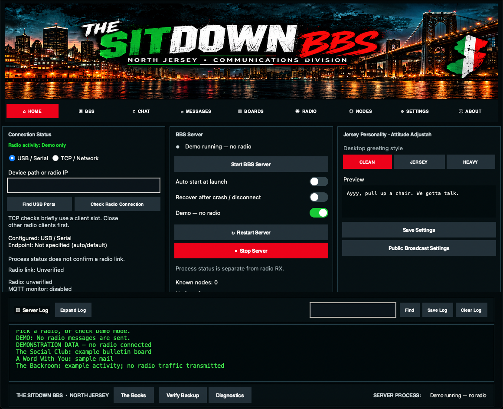

<div align="center">


## Jersey desktop and operator desks

The dashboard uses the reference-style nighttime waterfront banner, distressed
Jersey lettering, matching Dock icon, dark teal panels, red controls, and green
console text. The artwork is bundled locally for offline use.

The dashboard now has working tab pages for BBS utilities, local mail and boards,
radio status, full node lookup, settings, and About. Admin announcements and an
optional startup broadcast use the existing radio connection. Weather works with
an offline local report; internet weather and MQTT are separately **off by default**.

Read the [configuration and command guide](docs/JERSEY_DESK.md) and
[upstream audit](docs/UPSTREAM_AUDIT.md). This is a staged change: local utilities,
opt-in services, then desktop integration. Mac builds are test artifacts until
validated with a physical radio on an Intel Mac.


# 🤌 THE SITDOWN BBS
### 🇮🇹 North Jersey Communications Division 🇮🇹

**“Ayyy, pull up a chair. We gotta talk.”**

🖤 **Jersey Black** · ❤️ **Italian Red** · 💚 **Italian Green** · 🟡 **Diner Gold**

*A neighborhood social club for Meshtastic radio communications. Everybody's got connections.*

</div>

---

## 🥩 Welcome to the family

Around here, we don't just send messages. **We have sitdowns.**

**The Sitdown BBS** is a New Jersey–themed Meshtastic bulletin board server based on the open-source TC²-BBS project. Send direct messages over Meshtastic to access community bulletins, mail, channel information, and utilities—no internet required for the radio link.

Think old-school bulletin boards with a North Jersey attitude: diner coffee, Sunday gravy, and the eternal **pork roll vs. Taylor ham** debate. Whatever exit you're from, there's a seat at the table.

> **Important:** This is an independent community project with a fictional Italian-American social-club theme. It is not affiliated with any television show.

## 📻 What's in the family business?

| Jersey name | What it does |
| --- | --- |
| 🥩 **The Social Club** | Bulletin boards and community posts |
| ✉️ **A Word With You** | BBS mail |
| 🗺️ **What Exit?** | Channel directory |
| 📊 **Who's Connected?** | Server utilities and statistics |
| 🔮 **Jersey Wisdom** | Random fortunes |
| 🖥️ **The Sitdown Desktop** | Tabbed desktop with server status, searchable logs, operator desks, and full node lookup |
| 🧪 **Demo Mode** | Explore desktop controls without connecting or transmitting over radio |
| 📦 **The Books** | Create a ZIP backup of available local settings and database files |

**Hardware verification:** In October 2026 an earlier Intel Mac build launched, received a real Meshtastic message over TCP, and its menu reply was confirmed on the sending device. Nothing newer has been verified on a radio yet.

**Development note:** The desktop dashboard includes live server logs, process monitoring, USB port discovery, optional process restart, and a radio-free demo mode. Intel and Apple Silicon Mac builds are published to [The-Sitdown-BBS-Releases](https://github.com/TheLogsAreScreaming/The-Sitdown-BBS-Releases/releases). Over-the-air verification of direct messages, MQTT sending and USB connections is still pending.

## 🕵️ The Backroom — dashboard tools

The desktop app has a sidebar with four groups: **Overview** (Dashboard, Radio), **Mesh** (Chat, Nodes, Network), **BBS** (Mail, Boards, Broadcast) and **App** (Settings, About). Start or stop the server from the top-right button on any page. Dark and light themes and four text sizes are under **Settings → General**. Keyboard: ⌘1–⌘9 switch pages, ⌘, opens Settings, ⌘F searches the log. See [docs/UI_DESIGN_SYSTEM.md](docs/UI_DESIGN_SYSTEM.md).

| Control | What it does |
| --- | --- |
| **Dashboard** | Server status and controls, radio connection (USB or network, Find USB Ports, Check Radio Connection), MQTT network status with Connect/Disconnect, and the activity log |
| **Activity log** | Search (Find), Expand to a large window, Save… to a text file, or Clear the view without stopping the server |
| **Nodes** | Every node the app has heard, by radio or on MQTT, saved on your Mac (`~/.sitdown-bbs/node-directory.db`, up to 20,000). Your radio can only remember about 100 and forgets the oldest; this list keeps them. Filter by 1 hour / 24 hours / 7 days / All and by Radio or MQTT. The radio `/node` command searches the radio first, then this saved list |
| **Restart after a crash** | Optionally restart the server after an unexpected exit, with a growing delay capped at a minute |
| **Radio activity** | Shows when the radio last heard a packet, without claiming a permanent connection |
| **Backups** | Settings → General → Back up now… / Verify a backup… / Restore from backup… (checks the backup, saves a safety copy of your current files, then swaps the files in; the server must be stopped) |
| **Chat / Direct messages** | Chat has a tab per radio channel plus a ✉ tab per person. **New direct message** picks a heard node. For 10 minutes after you message someone, their plain replies come to your tab instead of the BBS menu (replies starting with `/` still reach the BBS); **End conversation** hands them back early. Ticks: ✓ relayed, ✓✓ delivered |
| **MQTT channel text** | Enter a channel's key on the CentralNJ or SJMesh Settings tab (**Channel keys**, `Name=PSK`, e.g. `LongFast=AQ==`). Text on that channel then shows in a 🌐 Chat tab. Channels without a key stay metadata only on the Network page. Keys stay in your local config (mode 600) and are never logged |
| **Integrations** | Off by default (`[integrations]` in `config.ini`). Webhooks for radio messages, nodes and telemetry; an assistant link so Claude can read the BBS radio's mesh (MCP, read-only unless you allow channel posts); Prometheus `/metrics`, InfluxDB line protocol and a Grafana dashboard. See [docs/INTEGRATIONS.md](docs/INTEGRATIONS.md) |
| **MQTT sending** | Off by default. Tick **Allow sending** on a network's Settings tab (channel key + `msh/<region>/2/e/<channel>/+` topic required) and that 🌐 tab gets a Send box. Messages are encrypted with the channel key and sent as your BBS radio's node id (or **Send as node id**). You confirm once per channel each session. ✓ broker accepted = the broker acknowledged it; ✓ on broker = the broker also echoed it back; ? no confirmation = neither within 2 minutes. Radios hear it only if a gateway downlinks that channel |

**Validation scope:** The October test is historical evidence only. v0.1.0-rc.14 has passed automated checks but still needs the [radio test session](docs/RADIO_TEST_SESSION.md) on real hardware, and the Apple Silicon build has not been run by a person on an M-series Mac. Node snapshots are not continuous presence checks.

### Jersey Mouth Control

Home provides **Clean Jersey**, **Jersey Attitude**, and **Full Jersey Mouth** greeting previews. Settings configures the generated startup broadcast greeting, with a separate public-profanity opt-in. Custom announcements, mail, and technical notices remain verbatim.

## 🤌 The Playbook — radio commands

Send these as **direct messages to the Meshtastic BBS node**.

| Command | Meaning |
| --- | --- |
| `/sitdown` or `/menu` | Back to the main menu |
| `/help` or `/ayyy` | Quick help |
| `/mail` or `/inbox` | Check your mail |
| `/boards` or `/socialclub` | Open the bulletin board |
| `/fortune` | Get a random fortune |
| `/tools` | Utilities |
| `/cancel` | Return to the main menu |
| `/node <ID or name>` | Full radio node lookup |
| `/weather` | Offline report or opt-in internet weather |
| `/wire` | Optional MQTT topic counts |
| `/announce <channel> <text>` | Administrator-only broadcast |

The original TC²-BBS one-letter menus and quick commands remain available alongside the Jersey shortcuts. More details: [SITDOWN_COMMANDS.md](SITDOWN_COMMANDS.md).

## 🖥️ Desktop preview (demonstration data)

**THE SITDOWN BBS — North Jersey Communications Division**

The current desktop dashboard uses Italian red and green accents, dark charcoal panels, and readable high-contrast controls. It includes **Start the Sitdown**, **Fuggedaboutit**, **The Playbook**, **The Family Business**, **The Books**, live searchable server logs, log export/clear controls, full node lookup, and a demo mode that does not require a connected radio.

**Demonstration data — no live radio connection.** The image below is captured automatically from the actual Tkinter dashboard on an Intel macOS GitHub Actions runner. It uses sample log entries, not real radio traffic. These screenshots come from the staged PR’s Intel Mac demo capture.



<details>
<summary>Operator desks, full node lookup, and opt-in settings (demo screenshots)</summary>


</details>

[Desktop screenshot automation](https://github.com/TheLogsAreScreaming/The-Sitdown-BBS/actions/workflows/readme-desktop-screenshot.yml) · [Mac releases](https://github.com/TheLogsAreScreaming/The-Sitdown-BBS-Releases/releases)

### 📦 Download the latest Mac build

[](https://github.com/TheLogsAreScreaming/The-Sitdown-BBS/actions/workflows/intel-mac-test-build.yml)

**[Download from The-Sitdown-BBS-Releases](https://github.com/TheLogsAreScreaming/The-Sitdown-BBS-Releases/releases)** · **[Test builds from GitHub Actions](https://github.com/TheLogsAreScreaming/The-Sitdown-BBS/actions/workflows/intel-mac-test-build.yml)**

- **Releases:** each release has two DMGs: `The-Sitdown-BBS-Intel-Mac-*.dmg` for Intel Macs and `The-Sitdown-BBS-Apple-Silicon-*.dmg` for M-series Macs (Apple menu → About This Mac shows which you have), plus `SHA256SUMS.txt`.
- **GitHub Actions:** Open a successful **Intel Mac test build** run and download the **The-Sitdown-BBS-Intel-Mac-Test** artifact. Artifacts expire after 14 days.
- **Both Mac types:** Intel (x86-64) and Apple Silicon (arm64) are built and tested separately. Builds are currently **unsigned and unnotarized**.
- **First launch:** open the app from Finder and give macOS a few minutes to check it — it can look frozen, but the app hasn't started yet. If it's blocked, use System Settings → Privacy & Security → **Open Anyway**. Each DMG has a **READ ME FIRST** and a `check-mac-launch.sh` checker; details in [docs/MAC_FIRST_LAUNCH.md](docs/MAC_FIRST_LAUNCH.md).
- **Demo mode:** Launch the app and enable **Demo mode (no radio)** to explore the dashboard without transmitting.
- **Live radio:** Configure your Meshtastic device before starting the real BBS server. A running process alone does not confirm a connected radio.

For packaging details see [INTEL_MAC_TEST_BUILDS.md](INTEL_MAC_TEST_BUILDS.md), and for release instructions see [RELEASE_PROCESS.md](RELEASE_PROCESS.md).

### 🛠️ Run from source

Requires **Python 3 with Tkinter** and the dependencies in `requirements.txt`.

```bash
git clone https://github.com/TheLogsAreScreaming/The-Sitdown-BBS.git
cd The-Sitdown-BBS
python3 -m venv venv
source venv/bin/activate
pip install -r requirements.txt
cp example_config.ini config.ini
# Review config.ini before connecting a radio.
python3 sitdown_desktop.py
```

Select **Demo mode** to explore without a radio. For the headless server run `python3 server.py`.

## 🎨 Jersey colors, not Joker colors

| Role | Color |
| --- | --- |
| Background | `#121212` Jersey Black |
| Panels | `#242424` Charcoal |
| Primary actions | `#C62828` Italian Red |
| Connected / start | `#008C45` Italian Green |
| Text | `#F5F5F0` Mozzarella White |
| Highlights | `#F4B942` Diner Gold |

No purple, no Joker branding. Just Jersey.

## 🧪 Development and testing

```bash
python3 -m unittest discover -s tests -p 'test_sitdown_commands.py'
```

GitHub Actions also checks syntax and the command alias tests. Hardware validation is still required before calling a radio release production-ready.

## 🙏 Respect to the original crew

**Upstream credit:** The Sitdown BBS is based on **TC²-BBS Meshtastic** by **TheCommsChannel (TC²)**. The original project provided the BBS architecture and Meshtastic integration; this fork adds its own Jersey theme, shortcuts, and desktop preview.

- [Original TC²-BBS-mesh project](https://github.com/TheCommsChannel/TC2-BBS-mesh)
- [Meshtastic](https://meshtastic.org/)
- [Python Meshtastic examples](https://github.com/meshtastic/python)
- [pdxlocations Meshtastic examples](https://github.com/pdxlocations/Meshtastic-Python-Examples)

**License:** GNU General Public License v3.0, consistent with the original project. Keep original copyright notices and license terms.

---

<div align="center">

### 🤌 “Fuggedaboutit. You're family now.”

**THE SITDOWN BBS** · *North Jersey Communications Division*

*Built for the mesh. Raised in Jersey.*

</div>
